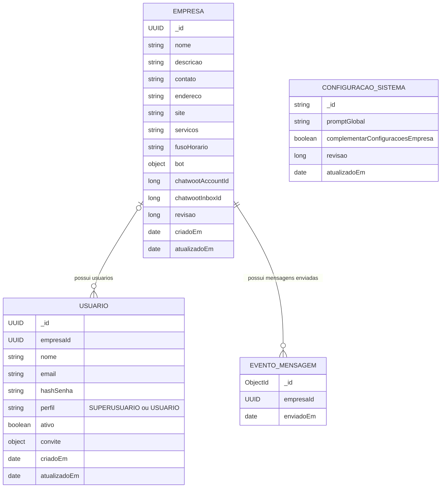

# ChatBot-IA-Mongo

Versão independente do painel ChatBot-IA com Angular, Spring Boot e MongoDB. Mantém login, isolamento por empresa, configurações do bot, administração, métricas. O repositório PostgreSQL original permanece separado.

## Diagrama da modelagem

Modelo implementado para simplificar o trabalho da faculdade. As quatro coleções de domínio são `empresas`, `usuarios`, `configuracoes_sistema` e `eventos_mensagens`; coleções técnicas de sessão não estão representadas.



Os nomes no diagrama representam documentos das coleções. As linhas indicam referências por `empresaId`, validadas pela aplicação, sem chaves estrangeiras impostas pelo MongoDB.

### Objetos dentro dos documentos

| Documento | Objeto embutido | Campos |
| --- | --- | --- |
| Empresa | `bot` | `ativo`, `nome`, `tomVoz`, `usarEmojis`, `instrucoes`, `instrucoesTransferencia` |
| Usuario | `convite` | `tokenHash`, `expiraEm`, `usadoEm` |

`bot` e `convite` não são coleções independentes. Os campos `chatwootAccountId` e `chatwootInboxId` ficam diretamente em `Empresa`, opcionais até a configuração da integração. Não há entidade nem objeto separado de vínculo Chatwoot.

### Regras do modelo

- O campo `perfil` define o acesso do usuário: `SUPERUSUARIO` administra o sistema e pode acessar todas as empresas; `USUARIO` acessa somente a empresa indicada por `empresaId`. Esses valores pertencem ao campo, sem coleção separada de perfis.
- Um usuário com perfil `USUARIO` pertence a uma única empresa. Um `SUPERUSUARIO` pode ficar com `empresaId` nulo; a empresa pode ter vários usuários.
- Cada empresa guarda uma configuração atual do bot, sem coleção de versões separada.
- `configuracoes_sistema` guarda um único documento compartilhado com o prompt global, sem histórico de versões.
- Cada documento em `eventos_mensagens` representa uma mensagem enviada: somente `_id`, `empresaId` e `enviadoEm`. Não há campo de quantidade nem conteúdo da mensagem.
- `enviadoEm` é uma data nativa do MongoDB, com horário completo em UTC, representada por `Instant` no Java. Os gráficos filtram o período e contam documentos agrupados por minuto, hora ou dia, considerando o fuso da empresa.
- Auditoria, candidatos e agendamentos ficam fora deste modelo.

Índices: e-mail único em `usuarios` e índice composto não único em `eventos_mensagens` sobre `empresaId` e `enviadoEm`. Empresa e horário não identificam uma mensagem de forma única. A integração envia `Idempotency-Key` com um ObjectId estável de 24 caracteres hexadecimais por mensagem; esse valor vira o `_id` do registro. Repetir o mesmo identificador e os mesmos dados não aumenta a contagem. Reutilizá-lo com outros dados retorna 409.

## Entidades e persistência

| Entidade | Coleção | Conteúdo |
| --- | --- | --- |
| `Empresa` | `empresas` | Dados do negócio, objeto `bot` e identificadores Chatwoot diretamente na empresa. |
| `Usuario` | `usuarios` | Login, perfil, referência da empresa e objeto `convite`. |
| `ConfiguracaoSistema` | `configuracoes_sistema` | Documento `principal` com o prompt global e sua revisão. |
| `EventoMensagem` | `eventos_mensagens` | Somente `_id` (ObjectId), `empresaId` (UUID) e `enviadoEm` (data/hora). |

Os modelos ficam em `backend/chatbot-model`, os repositories em `chatbot-repository`, as regras em `chatbot-service`, as APIs em `chatbot-resource` e a inicialização em `chatbot-boot`. Classes diretas, sem `Impl`. No Angular, cada funcionalidade mantém `classes`, `services` e pastas de telas.

Empresa, bot e Chatwoot compartilham a revisão da empresa. Uma gravação com revisão antiga retorna 409; um formulário com alterações não salvas mantém sua revisão original.

## Migração da modelagem anterior

A inicialização converte o modelo anterior de forma idempotente, preservando UUIDs de empresa/usuário, hashes de senha, convites, dados do bot, Chatwoot e prompt atual. O antigo `superusuario: true` vira `perfil: "SUPERUSUARIO"`; os demais usuários recebem `USUARIO` e a empresa do vínculo existente. Usuários comuns com vínculos ambíguos ou sem empresa válida interrompem a migração, sem escolher uma empresa automaticamente.

São mantidos somente os eventos antigos de mensagens **enviadas com sucesso**. Históricos de prompt/configuração e auditoria deixam de fazer parte do sistema. Depois de confirmar a conversão e os índices, a inicialização remove as coleções antigas. Faça um backup completo e pare instâncias da versão anterior antes da primeira inicialização com o novo código. A migração exige replica set.

Para migrar sem iniciar o servidor HTTP, depois do backup e da compilação:

```bash
mvn -f backend/pom.xml package
bash infra/migrar-modelagem.sh
```

O script usa `MONGODB_URI`, `infra/.env` ou a configuração local do projeto, assim como o backend. Consulte [persistência](docs/database.md) e [validação](docs/validation.md).

## Banco e desenvolvimento

Requer Java 25 LTS, Maven, Node 26.10 e MongoDB **replica set**. Transações protegem operações que envolvem vários documentos, como criação de empresa com usuário e migração. Um MongoDB standalone não basta. Um replica set de um membro atende ao teste, mas não oferece alta disponibilidade.

```bash
export JAVA_HOME=/caminho/do/seu/jdk-25
export PATH="$JAVA_HOME/bin:$PATH"
bash infra/start-mongo-local.sh
bash infra/run-backend-local.sh provision
bash infra/run-backend-local.sh
# Em outro terminal:
cd frontend
npm ci
npm start -- --port 4207 --proxy-config proxy.e2e.json
```

O banco local usa somente `127.0.0.1:27027`; o backend usa 8087. O provisionamento interativo cria o primeiro superusuário e empresa, com bot pausado. Não existe senha padrão nem autocadastro. O banco deve estar vazio. Não execute contra o banco de outro sistema.

A imagem local padrão é MongoDB 8.0. Em kernels incompatíveis com MongoDB 8, como o encontrado nesta máquina, o ambiente de testes foi validado com `MONGO_IMAGE=mongo:7.0 bash infra/start-mongo-local.sh`. Escolha a versão antes de criar o volume: não faça downgrade de um volume já usado por outra versão principal. Consulte a [matriz oficial de compatibilidade do kernel](https://jira.mongodb.org/browse/SERVER-125742).

Para outro servidor, defina `MONGODB_URI` no ambiente. O exemplo sem credenciais reais está em `infra/.env.example`. Codifique caracteres especiais da senha na URI. A conexão precisa de `uuidRepresentation=standard`, nome do banco dedicado, autenticação adequada e replica set. Senhas e tokens não pertencem ao Git ou frontend.

## Testar a API com Swagger UI

Com o backend local iniciado, abra http://localhost:8087/swagger-ui/index.html. A especificação JSON fica em http://localhost:8087/v3/api-docs.

Na seção **Autenticação**, abra `POST /api/auth/login`, clique em **Try it out**, informe `email` e `senha` e clique em **Execute**. O status 204 confirma o login. Depois execute `GET /api/auth/me` ou `GET /api/empresas`. O Swagger envia automaticamente o token CSRF nas gravações e usa a sessão do navegador. `POST /api/auth/logout` encerra a sessão.

O Swagger fica habilitado no perfil `local`. A variável `SWAGGER_ENABLED` controla sua ativação nos demais ambientes.

## Novas empresas e primeiro acesso

Entre como superusuário e abra **Negócios → Nova empresa**. Informe o nome da empresa, responsável e e-mail. O botão **Criar empresa e simular convite** não envia e-mail: mostra um link para testar a ativação. Abra-o em outra aba (ou janela anônima), informe o e-mail cadastrado e crie/confirme a senha. Depois entre pelo login normal. Em Negócios também é possível consultar o aceite ou simular um reenvio, invalidando o link anterior.

## Containers e atualização

A imagem unificada contém Angular compilado servido pelo Spring Boot na porta 8080. O banco é um serviço separado. Para construir localmente:

```bash
cp infra/.env.example infra/.env
# Preencha MONGODB_URI e tokens em infra/.env.
docker compose --env-file infra/.env -f infra/compose.yml up -d --build
docker compose --env-file infra/.env -f infra/compose.yml run --rm provision
```

O GitHub Actions em `.github/workflows/images.yml` testa o backend e o navegador, compila e publica a imagem privada no GHCR ao receber um push em `main`. Ela recebe a tag `sha-<commit>`; `latest` só é promovida depois que a publicação termina. Pull requests somente testam, sem publicar.

A VPS usa `infra/compose.images.yml` para baixar imagens prontas. O aplicativo não verifica o GitHub: o workflow pode avisar o EasyPanel por webhook após a publicação. Essa etapa exige cadastrar o secret `EASYPANEL_DEPLOY_URL` e a variável `EASYPANEL_AUTO_DEPLOY=true`, além do serviço e acesso ao registro privado no EasyPanel. Sem essa configuração, as imagens são publicadas, mas a VPS não muda. Veja [operação e atualização](docs/operations.md).

## Testes

```bash
bash infra/start-mongo-local.sh
cd backend && mvn verify
cd ../frontend && npm ci && npm run build
npx playwright install chromium
cd .. && bash infra/test-browser.sh
```

Os testes usam banco aleatório exclusivo no MongoDB local em 27027, sem credenciais de produção. Backend e testes de navegador removem seus bancos ao finalizar normalmente. Não chamam IA, Chatwoot ou n8n. Os testes de navegador usam a aplicação unificada na porta 8087; defina `E2E_BACKEND_PORT=18087` se sua aplicação local já estiver aberta.

## Limites desta versão

- Não transfere dados nem sessões existentes do PostgreSQL. O primeiro uso começa num banco MongoDB vazio. Uma migração de dados exige trabalho separado com backup e validação.
- SQL antigo está apenas em `docs/legado-postgres`, sem execução no backend.
- O escopo acadêmico mantém negócios, configurações do bot, convites, Chatwoot, administração e métricas.
- A configuração do painel não publica automaticamente mudanças num agente n8n existente.
- Deploy exige uma operação explícita. A migração da modelagem é executada na inicialização, conforme a seção de migração.

[API](docs/api.md) · [Banco](docs/database.md) · [Validação](docs/validation.md)


## Estrutura e JDK

O alvo deste repositório é Java 25 LTS. Configure também o SDK do projeto e o JDK do Maven da IDE para 25; `.java-version`, compilador, CI e imagens usam essa versão. Os scripts de desenvolvimento/teste recusam outro JDK. Node continua em 26.10, independentemente do Java.

O backend separa adaptação HTTP, casos de uso transacionais, contratos e repositories por responsabilidade. O frontend organiza telas, modelos em classes e serviços HTTP por funcionalidade. Veja o mapa e as decisões em [arquitetura](docs/arquitetura.md), e os resultados reproduzíveis em [validação](docs/validation.md).

O Dockerfile da raiz é o caminho principal de distribuição (Angular dentro do JAR). Os Dockerfiles separados em `backend/` e `frontend/` são alternativas mantidas para composição manual; não são o artefato publicado pelo workflow principal.
